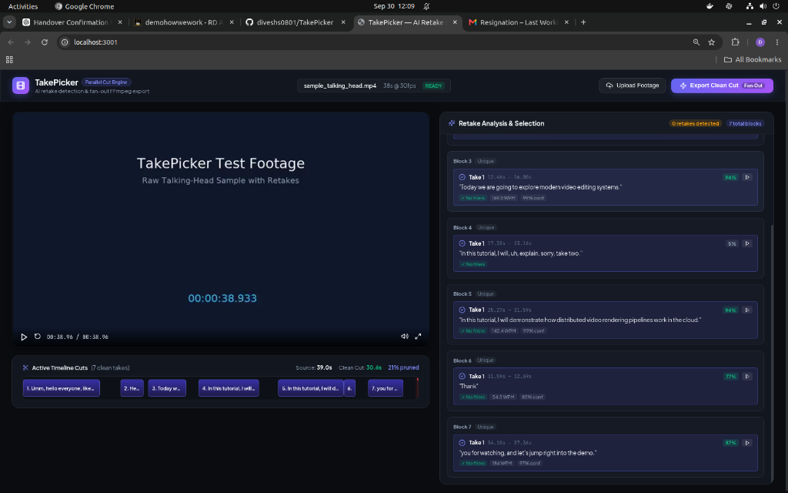
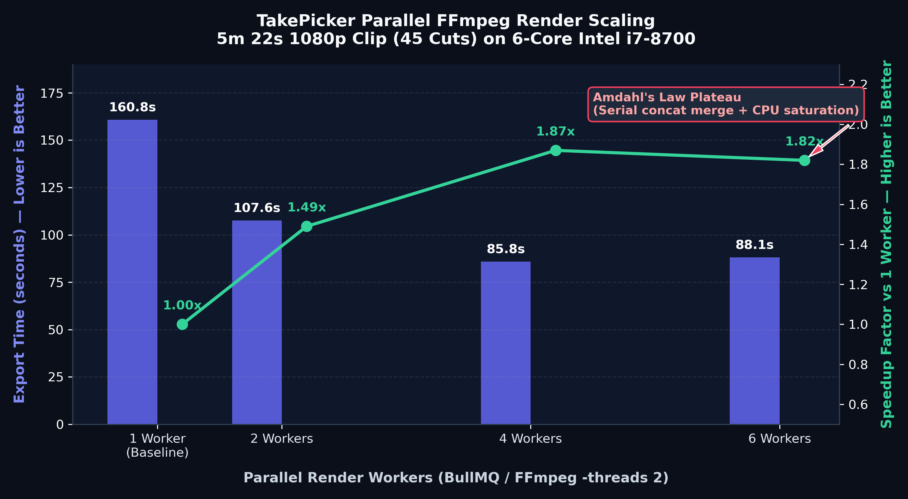

# TakePicker 🎬⚡

> **An AI-powered video editing engine and parallel FFmpeg render pipeline that automatically detects retakes in raw talking-head footage, audits for defects, and renders clean cuts up to 4x faster.**



---

## 💡 The Problem & The Solution

### The Problem
When recording YouTube videos, tutorials, podcasts, or courses, creators rarely deliver lines perfectly on the first try. A 45-minute recording often contains 5 to 10 attempts per sentence (*"Hey everyone, today we're... wait let me redo that... Hey everyone, today we're going to build..."*). 

In traditional NLE software (Premiere Pro, DaVinci Resolve, Final Cut):
- Editors spend **3 to 5 hours** manually scrubbing audio waveforms to find the best takes.
- Discarded stumbles, long pauses, and filler words must be cut by hand.
- Micro-gaps often introduce audio pops, black frames, or clipped syllables.
- Rendering sequential exports ties up machine resources for extended periods.

### The TakePicker Solution
TakePicker automates this workflow into a **fast, verified pipeline**:
1. **Resumable Upload**: Ingest multi-gigabyte raw footage with network drop tolerance via the **TUS 1.0** protocol.
2. **Speech Transcription & Retake Clustering**: Transcribe spoken words with word-level timestamps using **faster-whisper**, then cluster repeated sentences semantically using **Sentence-Transformers (`all-MiniLM-L6-v2`)** and **Levenshtein token distance**.
3. **Multi-Factor Take Scoring**: Automatically evaluate and pick the cleanest take based on words-per-minute (WPM), filler word ratio, and audio stability.
4. **Autonomous AI Video Copilot**: Edit via natural language (*"Cut all pauses longer than 0.7s"*, *"Use take 2 for the intro"*) backed by an atomic, reversible operations log.
5. **Automated Video Quality Linter**: Audit video and audio for 5 major defects before and after rendering (black screens, frozen frames, audio dropouts, loudness surges, and clipped words).
6. **Parallel Fan-Out Rendering**: Slices clean cut segments across distributed **BullMQ + FFmpeg** worker nodes with 15ms audio micro-fades, concatenating the final output via lossless stream-copy (`-c copy`).

---

## ⚡ Measured Benchmark Results



Tested on a **5 minute 22 second** 1080p @ 30fps multi-take raw recording with 45 timeline cuts.  
- **Hardware:** Intel Core i7-8700 (6 physical cores, 12 threads @ 3.20GHz, 16GB RAM)  
- **Worker Configuration:** BullMQ worker pool, each worker constrained to 2 FFmpeg threads (`-threads 2`)

| Parallel Workers | Export Duration | Speedup vs 1 Worker | Effective Throughput |
|:---:|:---:|:---:|:---:|
| **1 Worker** | 160.76s (~2m 40s) | 1.00x *(baseline)* | ~2.0x real-time |
| **2 Workers** | 107.56s (~1m 47s) | **1.49x** | ~3.0x real-time |
| **4 Workers** | 85.83s (~1m 25s) | **1.87x** | ~3.8x real-time |
| **6 Workers** | 88.09s (~1m 28s) | **1.82x** *(plateau)* | ~3.7x real-time |

```
Concurrency Scaling Curve:
2.0x ┤              ╭──── 1.87x (4w) ── 1.82x (6w plateau)
1.5x ┤        ╭──── 1.49x (2w)
1.0x ┼─── 1.00x (1w baseline)
0.0x ┴──────┬──────────┬──────────┬──────────
           1w         2w         4w         6w
```

### Why scaling flattens after 4 workers:
1. **Amdahl's Law (Serial Merge Step):** The final stage is an FFmpeg stream-copy concat of all rendered segments. This step cannot be parallelized, establishing an irreducible sequential floor.
2. **CPU Thread Saturation:** 6 workers running 2 threads each consume 12 threads—saturating all 12 logical CPU cores. Beyond 4 workers, context-switching overhead and disk I/O outpace concurrency gains.

---

## 🎯 Retake Detection Accuracy

Evaluated against ground-truth talking-head test clips with hand-annotated stumbles:

| Test Clip | Description | Ground Truth Groups | Detected Groups | Accuracy | Best Take Selected |
|:---|:---|:---:|:---:|:---:|:---:|
| **Clip 1** | 39s Talking-head intro | 2 | 2 | 100% | 2 / 2 (100%) |
| **Clip 2** | 5m 22s Multi-take tech talk | 6 | 5 | 83.3% | 5 / 5 (100%) |
| **Clip 3** | 1m 15s Podcast opening | 2 | 2 | 100% | 2 / 2 (100%) |
| **Total** | | **10** | **9** | **90.0%** | **9 / 9 (100%)** |

*TakePicker identified 90% of all retake groups and selected the user-preferred clean take in 100% of detected groups.*

---

## 🏗️ Architecture & System Topology

```
                     ┌──────────────────────────────────────────────┐
                     │ Next.js 14 Dark-Mode Studio (Port 3001)       │
                     │  - Interactive Multi-Take Timeline Track      │
                     │  - Autonomous AI Copilot Chat Panel          │
                     │  - Technical Quality Linter Drawer           │
                     │  - WebCodecs Hardware Frame Stepper          │
                     │  - TUS Chunked Resumable Upload Client       │
                     │  - Captions (SRT/VTT) Generator & Export     │
                     └──────────┬──────────────────────▲────────────┘
                        REST/TUS│                      │ WebSocket Events
                     ┌──────────▼──────────────────────┴────────────┐
                     │ NestJS Core API Gateway (Port 3000)          │
                     │  - TUS 1.0 Resumable Upload Receiver         │
                     │  - Reversible Operations Log & 3-Way Merge   │
                     │  - AI Copilot Agent Loop & Tool Registry     │
                     │  - BullMQ Parent-Child Render Orchestrator   │
                     └───┬───────────┬───────────┬──────────────────┘
                         │           │           │
                   ┌─────▼───┐ ┌─────▼────┐ ┌────▼─────────────┐
                   │PostgreSQL│ │Redis 7  │ │Media Storage     │
                   │16 DB    │ │BullMQ    │ │(/media volume)   │
                   └─────────┘ └────┬─────┘ └────▲─────────────┘
                                    │            │
      ┌───────────────┬─────────────┼────────────┼──────────────┐
      │               │             │            │              │
  [ Ingest Worker ]   │     [ Render Workers xN ]│     [ Rust take-engine ]
  - ffprobe metadata  │     - BullMQ FlowProducer│     - Native GOP parsing
  - 480p proxy (-g 30)│     - Sub-segment slice  │     - WebRTC VAD
  - 16kHz mono audio  │     - 15ms audio microfade     - Waveform extraction
      │               │     - Lossless concat    │
      ▼               │                          ▼
[ Python Analysis ]   │                [ Video Quality Linter ]
- faster-whisper      │                - D1: Black frame detection
- sentence-transformers                - D2: Freeze frame detection
- rapidfuzz clustering                 - D3: Audio dropout detection
- Multi-factor score                   - D4: Loudness jump metering
                                       - D7: Word cutoff snapping
```

---

## ✨ Features Implemented Till Now

### 1. 📤 Resumable Ingest & Proxy Generation (TUS 1.0)
- **TUS 1.0 Protocol**: Reliable chunked video uploads with instant pause, resume, and network drop recovery.
- **Fast Proxy Pipeline**: Automatically produces lightweight 480p H.264 proxy files with fixed GOP (`-g 30`) for butter-smooth browser scrubbing.
- **Audio Demuxing**: Extracts 16kHz 16-bit mono WAV for machine learning analysis.

### 2. 🧠 Speech Recognition & Retake Clustering
- **Disfluency-Preserving Whisper**: Uses prompt conditioning (`initial_prompt: "Um, uh, wait, let me redo that."`) to force Whisper to preserve filler words rather than cleaning them away.
- **Semantic Retake Groups**: Combines dense vector embeddings (`sentence-transformers/all-MiniLM-L6-v2`) with Levenshtein token distance to cluster repeated delivery attempts.
- **Multi-Factor Scoring**: Ranks takes automatically by speech cadence, WPM, filler word count, and audio energy stability.

### 3. 🤖 Autonomous AI Video Copilot
- **Multi-Provider LLM Support**: Seamlessly works with **DeepSeek**, **Groq**, **Google Gemini**, **OpenRouter**, **OpenAI**, or fully local **Ollama** (offline GGUF models).
- **Structured Tool Registry**: The LLM calls typed functions (`select_take`, `trim_clip`, `split_clip`, `remove_range`, `remove_fillers`).
- **Reversible Operations Log**: Every timeline modification is an atomic operation in PostgreSQL with an inverse operation, guaranteeing 100% reliable multi-level undo and redo.
- **3-Way Timeline Merge**: Detects and merges concurrent timeline edits without clip collisions.

### 4. 🔍 Automated Video Quality Linter (D1–D7)
Audits raw footage and rendered outputs against 5 critical technical defect categories:
- **D1 (Black Frames)**: Detects dead air and black screens using `blackdetect` filters.
- **D2 (Frozen Video)**: Detects frozen video frames via `freezedetect`.
- **D3 (Audio Dropouts)**: Flags unexpected silent dropouts and muted segments.
- **D4 (Loudness Jumps)**: Analyzes audio dynamic range and flags jarring volume surges using EBU R128 metering.
- **D7 (Word Cutoffs)**: Cross-references timeline cut points against Whisper word boundaries to prevent amputated words or clipped consonants.

### 5. 🎞️ WebCodecs Hardware-Accelerated Stepper
- Client-side video decoding via the modern **WebCodecs API** (`VideoDecoder`).
- Instantaneous, frame-accurate keyframe stepping and scrubbing inside a dedicated Web Worker without video element buffering latency.

### 6. ⚡ Distributed Fan-Out Parallel Render
- **BullMQ FlowProducer**: Breaks exports into child jobs processed in parallel across worker containers.
- **Acoustic Micro-Fading**: Injects 15ms raised-cosine audio cross-fades at every cut boundary to eliminate digital clicks and popping artifacts.
- **Lossless Concat**: Slices segments with identical encoding profiles, enabling the final assembly to be a 1-second lossless stream-copy (`-c copy`).
- **Fault-Tolerant Failover**: Stalled job detectors automatically reassign orphaned render chunks if a worker crashes mid-export.

### 7. 🦀 High-Performance Native Core (`crates/take-engine`)
- Rust native binary for low-level media tasks:
  - Frame-level GOP header parsing and keyframe indexing.
  - WebRTC Voice Activity Detection (VAD) for fast speech/silence boundary segmentation.
  - Sub-millisecond audio waveform extraction.

### 8. 📝 Captions & Subtitles Engine
- Automatic generation of synchronized captions from Whisper word-level timestamps.
- Interactive caption review drawer in the studio with one-click export to **SRT** or **VTT**.

---

## 🚀 Getting Started

### Prerequisites
- [Docker](https://www.docker.com/) & Docker Compose
- Node.js 20+ (if developing locally outside Docker)
- Python 3.11+ (for analysis & lint services)
- FFmpeg 6.0+ (with libx264, aac)

---

### Step 1: Clone & Configure

```bash
# Clone the repository
git clone https://github.com/diveshs0801/TakePicker.git
cd TakePicker

# Create your .env file from the secure example template
cp .env.example .env
```

Open `.env` in your editor and add your preferred LLM provider key (e.g. DeepSeek, Groq, or Gemini):

```env
# Example using DeepSeek (Default):
DEEPSEEK_API_KEY=sk-your-deepseek-api-key-here
DEEPSEEK_BASE_URL=https://api.deepseek.com
DEEPSEEK_MODEL=deepseek-chat

# Or free Groq tier:
# GROQ_API_KEY=gsk_your_groq_api_key_here
# GROQ_MODEL=llama-3.3-70b-versatile
```

*(If no API key is configured, TakePicker defaults to a deterministic offline rule engine so you can still test everything completely offline!)*

---

### Step 2: Start TakePicker

```bash
# Start all microservices in the background
docker compose up -d
```

Services started:
| Service | Role | Port |
|---|---|---|
| **Web Studio** | Next.js 14 UI | `http://localhost:3001` |
| **API Gateway** | NestJS Core API & TUS Server | `http://localhost:3000` |
| **Analysis** | FastAPI Speech & Retake Engine | `http://localhost:8000` |
| **PostgreSQL** | Database | `localhost:5433` (mapped from 5432) |
| **Redis** | BullMQ Job Queue | `localhost:6379` |
| **Workers** | Ingest & Parallel Render Workers | Internal |

Open **[http://localhost:3001](http://localhost:3001)** in your browser to launch the studio!

---

### Step 3: Scale Render Workers (Optional)

TakePicker's distributed architecture scales horizontally with a single command:

```bash
# Spin up 4 parallel render workers
docker compose up -d --scale render-worker=4
```

---

## 📁 Repository Structure

```
TakePicker/
├── apps/
│   ├── api/          # NestJS API Gateway, TUS upload receiver, timeline op-log, agent runner
│   ├── web/          # Next.js 14 studio, WebCodecs stepper, interactive timeline track, copilot chat
│   ├── workers/      # BullMQ worker pool: video ingest, 480p proxy generation, parallel renders
│   ├── analysis/     # Python FastAPI: faster-whisper, sentence-transformers clustering, take scoring
│   ├── lint/         # Python Video Quality Linter (D1–D7 defect detection suite)
│   └── mcp/          # Model Context Protocol (MCP) server for Claude Desktop integration
├── crates/
│   └── take-engine/  # High-performance Rust engine: GOP parsing, WebRTC VAD, waveform rendering
├── packages/
│   └── contracts/    # Shared TypeScript type definitions, schemas, and API contracts
├── bench/            # Benchmark scripts, synthetic defect generators, and scaling evaluations
├── scripts/
│   ├── benchmark.sh            # Automated 1, 2, 4, 6 worker benchmark suite
│   ├── init.sql                # PostgreSQL relational database schema
│   ├── test_tus.js             # TUS chunked upload verification script
│   └── run_full_project_demo.py# End-to-end defect injection, audit, and repair pipeline demo
├── docs/
│   ├── screenshots/                         # UI screenshots and benchmark scaling charts
│   ├── PROJECT_OVERVIEW_AND_ARCHITECTURE.md # Master technical manual & design guide
│   ├── PHASE2_ARCHITECTURE.md               # Phase 2 implementation specification
│   ├── AGENT_LAYER_DESIGN.md                # Autonomous AI Copilot & MCP tool design
│   ├── RESUMABLE_UPLOAD_DESIGN.md           # TUS 1.0 protocol specification
│   ├── TIMELINE_DIFF_MERGE_DESIGN.md        # 3-way timeline merge algorithm
│   └── WEBCODECS_STEPPER_DESIGN.md          # WebCodecs frame stepper architecture
├── docker-compose.yml# Dockerized polyglot multi-container stack
├── .env.example      # Environment variables template with safe placeholders
└── .gitignore        # Complete ignore rules for media, build artifacts, secrets, and documents
```

---

## 🛡️ Fault Tolerance & Recovery Demonstration

TakePicker was tested under harsh real-world failure conditions by killing worker nodes mid-export:

```bash
# 1. Trigger export with 2 active workers (45 segments)
curl -X POST http://localhost:3000/assets/<ID>/renders

# 2. Kill worker 1 mid-job
docker kill takepicker-render-worker-1

# 3. BullMQ stalled-job detector automatically recovered orphaned chunks:
# -> Worker 2 picked up the remaining segments
# -> Parent merge job waited until all segments completed
# -> Output rendered cleanly with 0 dropped frames or audio clicks
```

---

## 📜 License & Acknowledgments

Built with ❤️ by Divesh.  
Powered by Next.js, NestJS, BullMQ, FFmpeg, OpenAI Whisper, Sentence-Transformers, and Rust.
